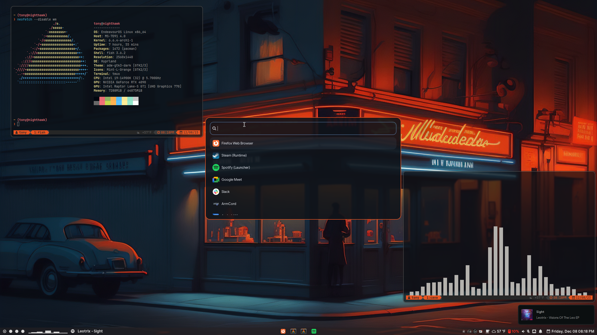

# nosduco's dotfiles

A collection of sane dotfiles I share between my machines as a software engineer/manager/hobbyist. Declared with NixOS flakes + home-manager.



## Stack

- **OS**: NixOS (flakes + home-manager)
- **WM**: Hyprland
- **Terminal**: Ghostty + tmux + fish
- **Editor**: Neovim
- **Shell Prompt**: Tide
- **Theme**: Catppuccin Mocha

## Hosts

- `nighthawk` - desktop
- `voyager` - laptop
- `daemon` - agent VM

## Layout

- `flake.nix` - inputs + host definitions
- `hosts/` - system config (`common/core`, `common/optional`, per host)
- `home/tony/` - home-manager config (`common` + per host)
- `config/` - raw configs linked in by home-manager
- `secrets/` - sops-encrypted secrets

## Installation

Boot the NixOS installer on the target and set a root password (`sudo passwd root`), then from another machine in this repo:

```bash
nix run .#install -- <host> <ip>
```

Full steps (Secure Boot, TPM unlock): [docs/bootstrap.md](docs/bootstrap.md).

## Updates

nighthawk is updated by hand. `nh os switch -a` applies config changes; commit and push them so voyager and daemon pick them up. An hourly check notifies about new commits on `main`, unpushed changes, and input updates once the last one is a week old.

tux prebuilds input updates on the `flake-update` branch. `os-update` applies them: it shows the package diff, asks, then commits and pushes `flake.lock`. `nh os switch -u -a` updates all inputs to the latest instead, without the prebuild.

voyager and daemon deploy the signed tip of `main` automatically via comin. On battery, voyager holds updates until it is plugged in; `comin resume` installs them now.
